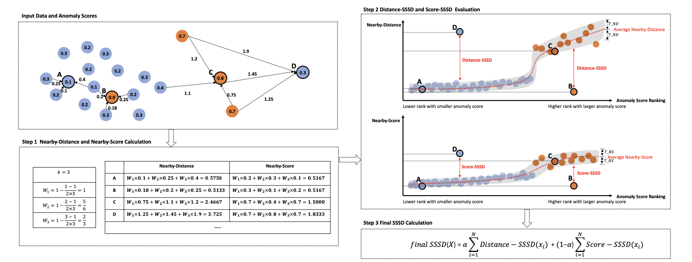

# SSSD

Official implementation of the paper:

**Internal Evaluation of Unsupervised Anomaly Detection Algorithms with Explanation**

**Authors:** Yue Shao, Baile Xu, Furao Shen, and Jian Zhao

**Venue:** NeurIPS 2026, Evaluations & Datasets Track

## Overview


SSSD (Similar Scores, Similar Data) is an internal evaluation framework for unsupervised anomaly detection.

It is designed to evaluate whether anomaly scores are consistent with the local structure of the input data. Intuitively, data points with similar characteristics should receive similar anomaly scores. A larger SSSD value indicates a stronger violation of this score--data consistency and suggests a higher probability of unreliable detection for the corresponding data point.


## Installation

```bash
pip install -r requirements.txt
```


## Repository Structure

```text
SSSD-main/
├── README.md
├── requirements.txt
├── SSSD.py
├── notebooks/
│   ├── 01_toy_example.ipynb
│   ├── 02_synthetic_experiments.ipynb
│   └── 03_realworld_experiments.ipynb
├── dataset/
│   ├── artificial/
│   ├── realworld/
└── assets/
    └── Framework.png
```

## Notebooks

### 1. Toy Example

01_toy_example.ipynb

A minimal 2D visualization example demonstrating the intuition behind SSSD and score-data consistency.

### 2. Synthetic Experiments

02_synthetic_experiments.ipynb

Experiments on synthetic datasets for validating the effectiveness of SSSD.

### 3. Real-world Experiments

03_realworld_experiments.ipynb

Experiments on real-world anomaly detection datasets using multiple anomaly detectors.

## Data

The data in this repository are used for the experimental evaluation of SSSD. SSSD itself takes input features and anomaly scores; ground-truth labels are used only for external evaluation.

### Synthetic data

The nine synthetic datasets in `dataset/artificial/` were generated for the experiments described in the paper. Datasets 1-5 are two-dimensional; Datasets 6-9 have 5, 10, 15, and 20 features, respectively.

Each data file is paired with a ground-truth file named `DataSet<n>GT`. Labels use `0` for normal samples and `1` for anomalies.

### Real-world data

The repository contains 16 real-world dataset files from two sources:

- **[ODDS](https://shebuti.com/outlier-detection-datasets-odds/):** nine `.mat` files directly under `dataset/realworld/`: `glass.mat`, `ionosphere.mat`, `letter.mat`, `lympho.mat`, `satellite.mat`, `satimage-2.mat`, `vertebral.mat`, `vowels.mat`, and `wbc.mat`.
- **[DAMI](https://www.dbs.ifi.lmu.de/research/outlier-evaluation/DAMI/):** seven
  `.arff` files in the `InternetAds/`, `Ionosphere/`, `Lymphography/`, `Shuttle/`, `WBC/`, `WDBC/`, and `Waveform/` subdirectories of `dataset/realworld/`.

ODDS `.mat` files contain `X` (features) and `y` (labels, with `1` denoting an anomaly). The DAMI `.arff` files contain feature fields, an `id` identifier, and an `outlier` label (`yes` for an anomaly and `no` for a normal sample).

## Using SSSD in Your Own Code

```python
from SSSD import SSSD

# X: input data, shape (n_samples, n_features)
# scores: anomaly scores, shape (n_samples,)
sssd = SSSD(X, scores, k=5, m=5)

final_sssd, final_sssd_sum, ranked_indices = sssd.get_final_SSSD()
score_sssd, score_sssd_sum, score_ranked_indices = sssd.get_Score_SSSD()
distance_sssd, distance_sssd_sum, distance_ranked_indices = sssd.get_Distance_SSSD()
```

Output interpretation:

- `final_sssd`: point-wise SSSD values in the original sample order.
- `final_sssd_sum`: aggregated SSSD value over all samples.
- `ranked_indices`: sample indices sorted by descending SSSD value. Samples ranked earlier are more likely to violate score--data consistency.

## Notes

* Larger SSSD values indicate stronger violations of score-data consistency.
* The implementation supports arbitrary anomaly detectors that output anomaly scores.

## Citation

If you find this repository useful in your research, please consider citing our paper:

```bibtex
@inproceedings{shao2026sssd,
  title     = {Internal Evaluation of Unsupervised Anomaly Detection Algorithms with Explanation},
  author    = {Shao, Yue and Xu, Baile and Shen, Furao and Zhao, Jian},
  booktitle = {Advances in Neural Information Processing Systems},
  year      = {2026}
}
```

## License

The source code of SSSD is released under the MIT License. See the [LICENSE](LICENSE) file for details.

Third-party datasets remain subject to their original licenses and terms of use.
